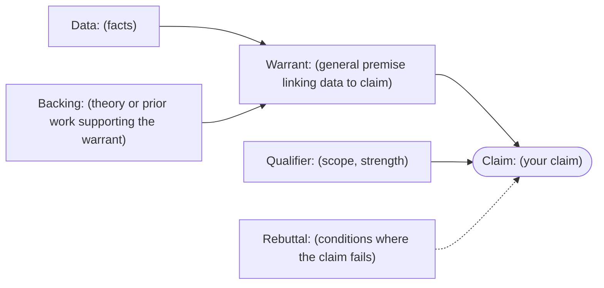
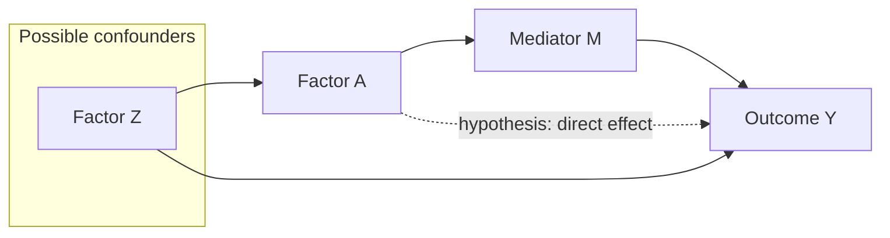
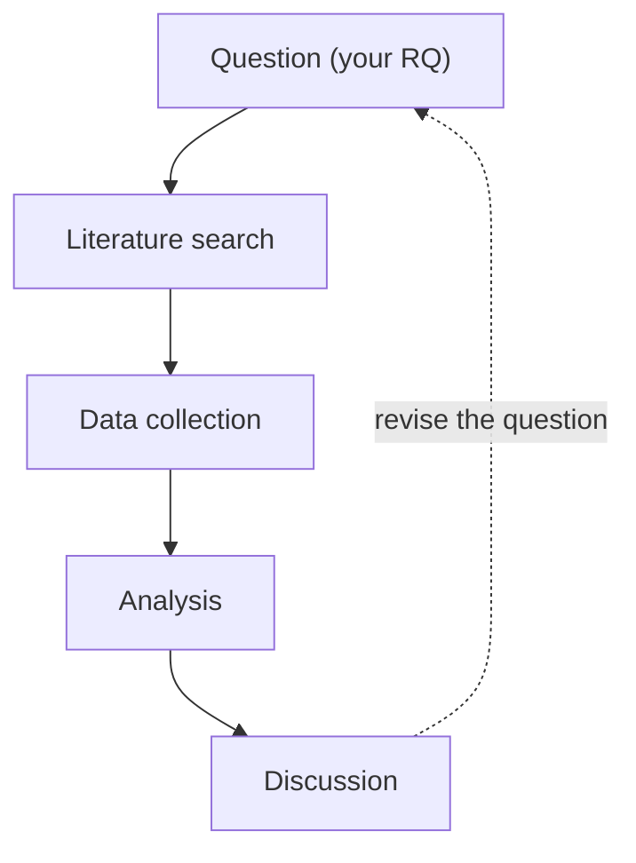
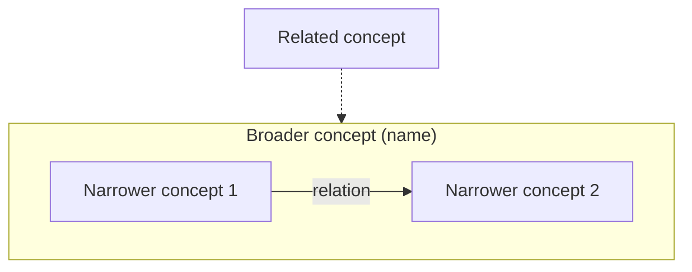

<!-- Format samples only. Labels are placeholders such as "(claim)" or "Factor A" and contain no topic.
     Copy what you need into your manuscript and write the content yourself. Each Mermaid diagram pins
     theme, look and layout in front matter (Mermaid 12 changed the defaults: Mermaid, Flowchart syntax,
     "Default theme, look and layout (v12.0.0+)", https://mermaid.js.org/syntax/flowchart.html). -->

# Math (TeX) {#sec-math}

Inline math such as $\bar{x} = \frac{1}{n}\sum_{i=1}^{n} x_i$, and display math:

$$
\hat{\beta} = (X^{\top}X)^{-1}X^{\top}y
$$

$$
\begin{aligned}
y_i &= \beta_0 + \beta_1 x_i + \varepsilon_i \\
\varepsilon_i &\sim \mathcal{N}(0, \sigma^2)
\end{aligned}
$$

# Diagrams (Mermaid) {#sec-figures}

## Argument map (Toulmin layout)



## Causal diagram (hypothesised links dotted)



## Research flow



## Timeline


## Concept map



# Tables {#sec-tables}

| Item | Value | Source id |
|---|---:|---|
| (item 1) | (value) | S001 |
| (item 2) | (value) | S002 |

: Table 1 (caption; above or below the table as your guide requires) {#tbl-sample}

# Footnotes {#sec-notes}

Add a note where needed[^n1].

[^n1]: Note text. Whether sources go in notes or in the text depends on your citation style.

# Cross-references {#sec-xref}

Refer to sections like [the math section](#sec-math). Numbered references to figures/tables/equations
(@fig:...) need pandoc-crossref built for your pandoc version (pandoc-crossref README,
https://github.com/lierdakil/pandoc-crossref).

# Citations (sample, not processed)

```text
In-text: [@key, p. 12] / several: [@key1; @key2] / author in text: @key argues ...
key = the citekey or id in the ledger (sources/register.csv). The bibliography is built from the ledger at each export; only IDENTITY_CONFIRMED works appear.
```
