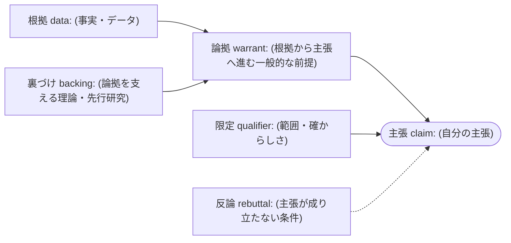
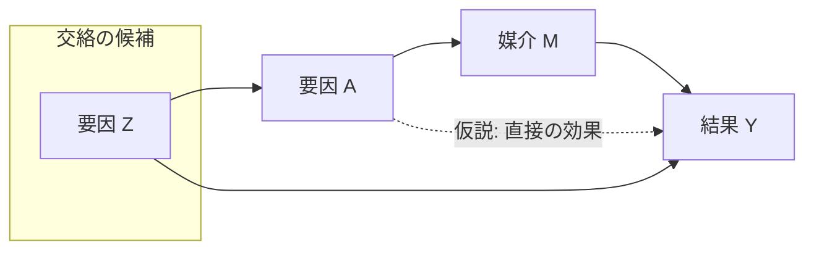
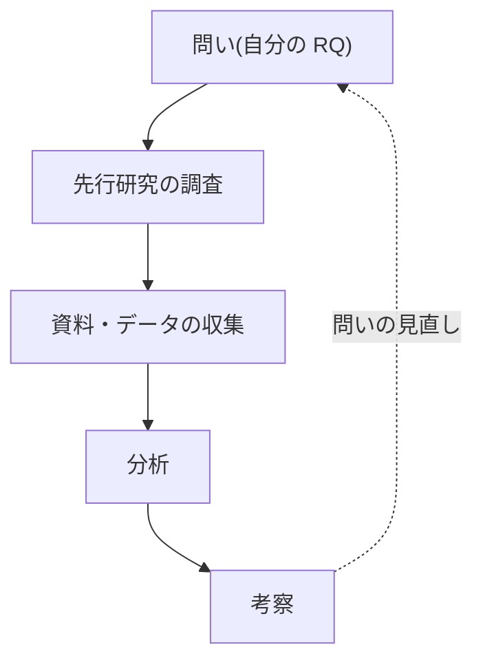
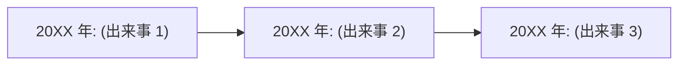
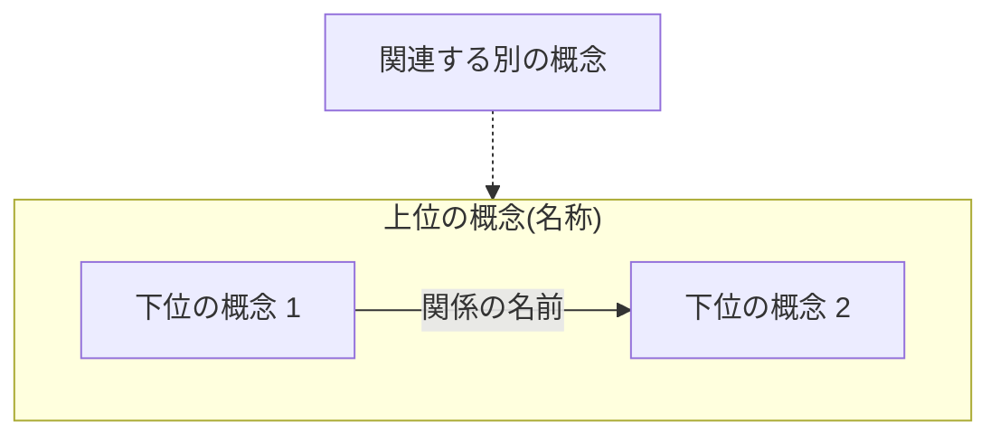

<!-- 形式の見本だけを置く。ラベルは「(主張)」「要因 A」のような空欄で、どのテーマの内容も含めない。
     必要な部分を自分の原稿に写して、中身は自分で書く。Mermaid 図は先頭の front matter で
     theme・look・layout を固定する(Mermaid 12 で既定の見た目が変わったため。Mermaid の Flowchart syntax、
     https://mermaid.js.org/syntax/flowchart.html の「Default theme, look and layout (v12.0.0+)」)。 -->

# 数式(TeX 記法) {#sec-math}

本文中の数式は $\bar{x} = \frac{1}{n}\sum_{i=1}^{n} x_i$ のように書く。独立した数式は次のように書く。

$$
\hat{\beta} = (X^{\top}X)^{-1}X^{\top}y
$$

複数行をそろえるときは aligned を使う。

$$
\begin{aligned}
y_i &= \beta_0 + \beta_1 x_i + \varepsilon_i \\
\varepsilon_i &\sim \mathcal{N}(0, \sigma^2)
\end{aligned}
$$

# 図(Mermaid) {#sec-figures}

## 論証図(Toulmin の要素の配置)



## 因果図(仮説の矢印は点線)



## 研究の流れ



## 年表(年ごとの出来事を左から右へ)



## 概念図(概念の包含と関係)



# 表 {#sec-tables}

| 項目 | 値 | 出典 id |
|---|---:|---|
| (項目 1) | (値) | S001 |
| (項目 2) | (値) | S002 |

: 表 1 (表の題。表の上に置くか下に置くかは学部の指定に従う) {#tbl-sample}

# 脚注 {#sec-notes}

注が必要な箇所に番号を付ける[^n1]。

[^n1]: 注の本文。出典を注で示す方式か、本文中に示す方式かは学部の指定に従う。

# 相互参照 {#sec-xref}

節への参照は [数式の節](#sec-math) のように書く(pandoc の見出し属性と内部リンク)。
図・表・式の番号つき参照(@fig:… など)を使うなら pandoc-crossref を入れる(pandoc の版と一致させる必要がある。pandoc-crossref の README: https://github.com/lierdakil/pandoc-crossref)。

# 引用の書き方(処理されない見本)

```text
本文中の引用: [@key, p. 12]  /  複数: [@key1; @key2]  /  著者名を本文に出す: @key は〜と述べる
key は台帳(sources/register.csv)の citekey か id。文献一覧は書き出しのたびに台帳から作る。台帳で IDENTITY_CONFIRMED の文献だけが出る。
直接引用は「」で区別し、頁を示す(著作権法32条・48条)。
```
